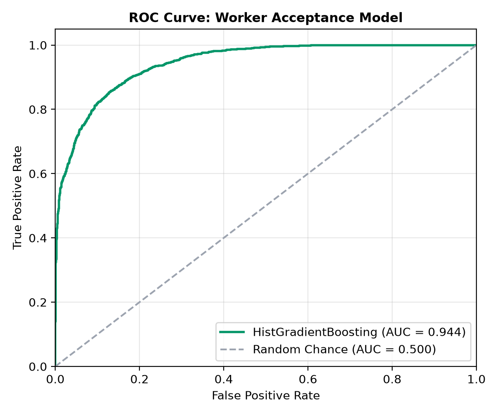
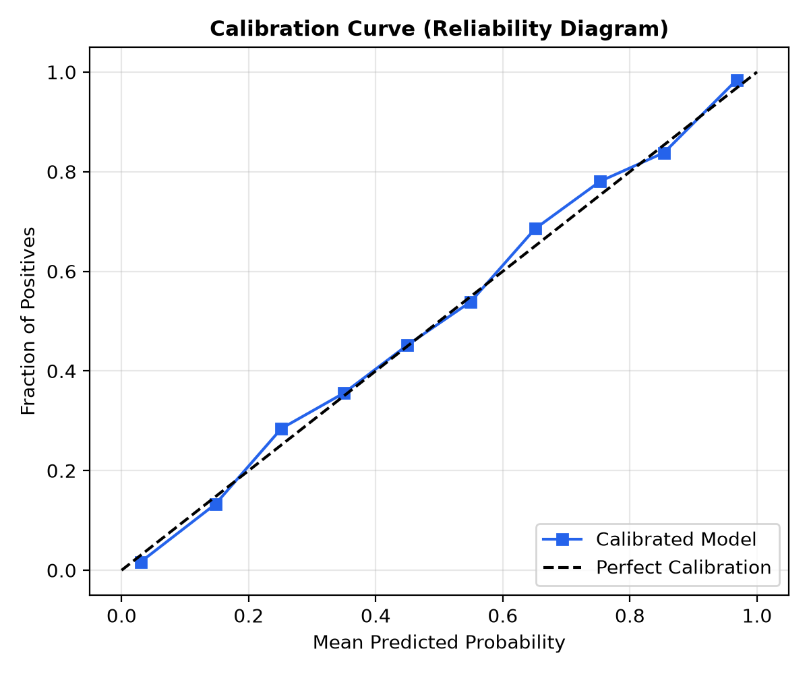
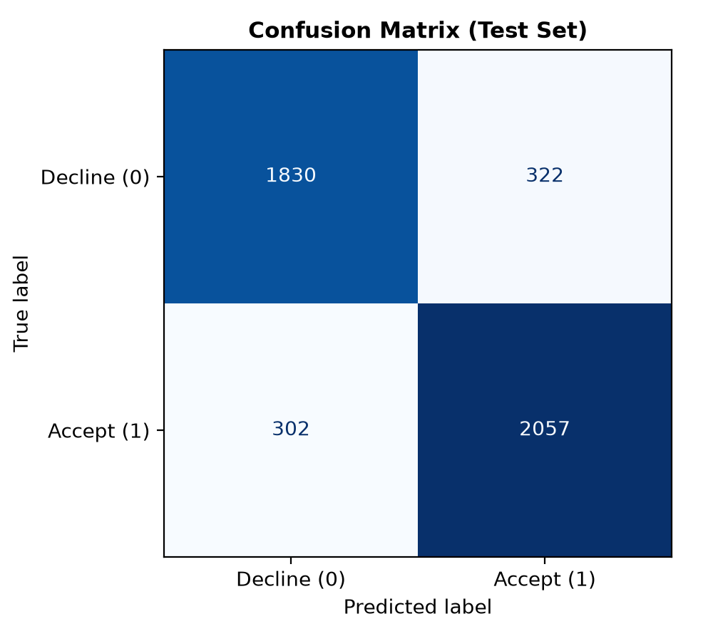
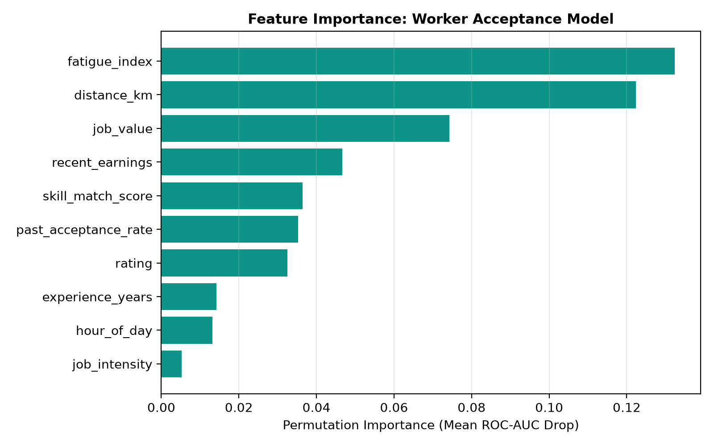
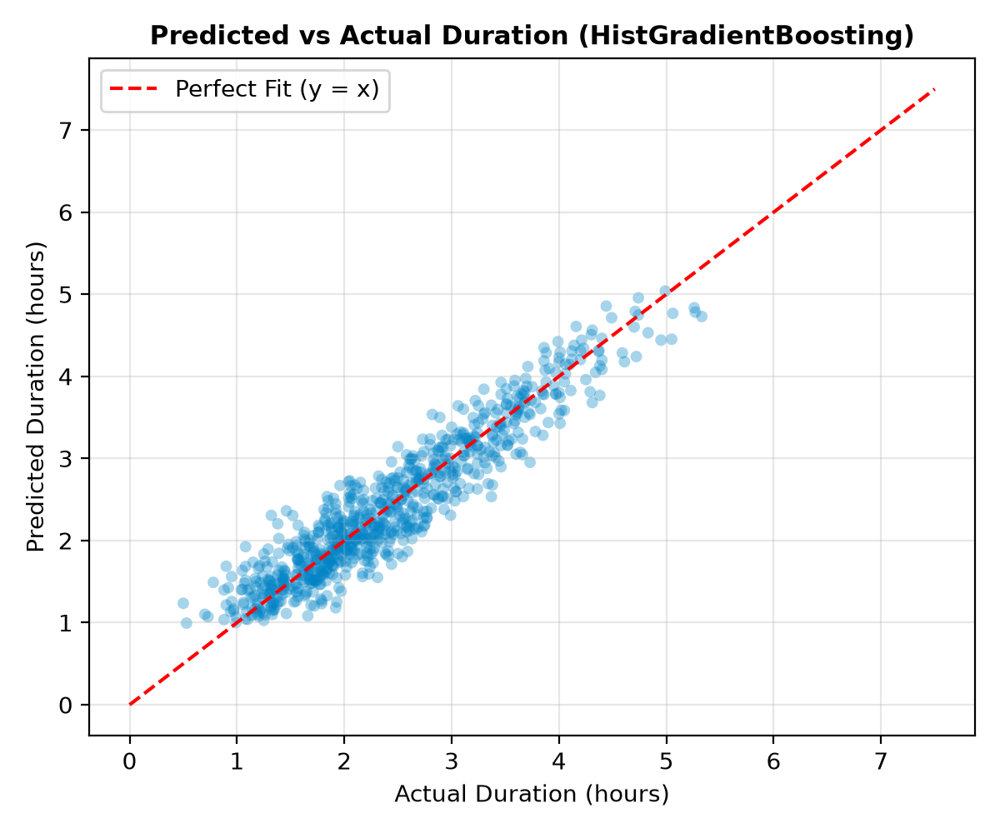
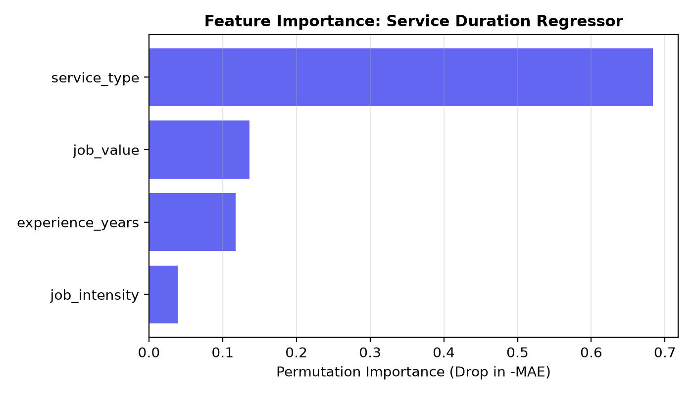

# Machine Learning Module Report: Sahakar Sathi

**Project Title:** Multi-Objective Fair Gig Dispatching with Calibrated Machine Learning Tie-Breaking  
**Application:** Sahakar Sathi Cooperative Gig Platform  
**Target Audience:** Academic Evaluators and Mini-Project Examination Committee  
**Authors:** Cooperative Engineering Team  
**Date:** October 2026  

---

## 1. Problem Statement

Gig economy platforms typically optimize matching purely for platform efficiency—maximizing corporate margin or minimizing immediate delivery latency. In contrast, **Sahakar Sathi** is an autonomous worker cooperative designed to balance service quality, worker livelihoods, and long-term health.

However, matching in real-world gig environments introduces two opposing hazards:

1. **The Fragility of Pure Rule-Based Matching:**
   A deterministic multi-factor scoring formula (weighting skills, location, availability, rating, experience, and economic deficit) makes static assumptions about worker willingness. If the engine dispatches a job to a top-ranked worker who is personally fatigued, working late hours, or sent across town for low remuneration, that worker is likely to decline. Every rejected offer triggers sequential re-dispatching, inflating booking latency and degrading customer retention.

2. **The Injustice of End-to-End Pure Machine Learning Matching:**
   Conversely, training an end-to-end ML model (such as a neural network or greedy bandit) to directly assign jobs creates acute algorithmic bias:
   - **Feedback Loops:** Highly active workers receive all subsequent jobs because their historical acceptance probability is high.
   - **Gini Explosion:** Workers needing income who decline distant or low-paying jobs are systematically starved of future offers.
   - **Health Violations:** An algorithm optimizing short-term acceptance will ruthlessly overwork reliable workers past physical exhaustion caps.

**The Hybrid Cooperative Solution:**  
Sahakar Sathi preserves the **six-factor cooperative allocation policy** as the primary sovereign decision-maker. Machine learning is restricted to a **bounded tie-breaker**: when multiple verified, qualified workers have virtually identical multi-factor scores, the platform breaks the tie in favor of the worker most likely to accept.

---

## 2. Architecture and Non-Interference Guarantee

### System Architecture
The dispatch pipeline follows a strict hierarchical filtering architecture:

```
[ Incoming Service Request ]
            │
            ▼
[ Candidate Filtering & Eligibility ]
   - Sector / Trade Match
   - KYC Verification (VERIFIED status)
   - Availability Flag (AVAILABLE)
            │
            ▼
[ Hard Safety Floor: Fatigue Cap Check ]
   - Exponential Load Decay over 7 days: Load = Σ (Intensity × Hours × 0.8^days_ago)
   - Fatigue Index = min(100, Load / 18.0 × 100)
   - IF Fatigue Index >= 80.0 ──► WORKER HARD BLOCKED (Excluded from Pool)
            │
            ▼
[ Deterministic 6-Factor Scoring ]
   - Skill Match (30%) + Location (20%) + Availability (20%)
   - Rating (10%) + Experience (10%) + Workload Fairness (10%)
            │
            ▼
[ Deterministic Candidate Ranking ]
   - Candidates sorted descending by Score
            │
            ▼
[ Decision Gate: Score Margin <= 2.0 within Top-3? ]
      │                                       │
     NO (Clear Winner)                       YES (Tie-Break Condition)
      │                                       │
      ▼                                       ▼
[ Dispatched in Deterministic Order ]    [ Calibrated ML Acceptance Inference ]
                                          - Re-order ONLY candidates in margin window
                                          - Highest predicted probability offered first
                                          - Remaining candidates maintain score ranks
```

### Decision Example & Non-Interference Guarantees
1. **Can ML Re-order the Top Candidate?**
   **Yes, by design in close tie-break conditions.**  
   *Code Path (`backend/app/services/matching/engine.py`):*
   ```python
   top_score = recommendations[0].score
   k_limit = min(len(recommendations), 3)
   margin = 2.0
   tie_indices = [i for i in range(k_limit) if (top_score - recommendations[i].score) <= margin]
   if len(tie_indices) > 1:
       reordered = sorted(subset, key=lambda c: (c.ml_accept_probability, c.score), reverse=True)
       recommendations[:len(reordered)] = reordered
   ```
   *Concrete Example:*  
   - Candidate A (Worker 10) scores **88.0** with acceptance probability **0.42** (higher recent earnings, higher fatigue).
   - Candidate B (Worker 14) scores **87.1** with acceptance probability **0.94** (under-earning, low fatigue).  
   Because Candidate B is within $2.0$ points of Candidate A inside the top 3, ML tie-breaking re-orders `[Candidate B, Candidate A]`. Candidate B is moved to Rank 1 and dispatched first.
2. **Strict Safety Floor Invariance:**
   The fatigue threshold ($FatigueIndex \ge 80.0$) and peer verification checks execute *prior* to scoring and ML inference. A fatigued or unverified worker is excluded in candidate filtering; the ML module has zero mathematical pathway to inspect or promote an excluded worker.
3. **Skill Invariance & Pre-Scoring Exclusion:**
   Workers lacking the required profession or skill domain are eliminated before candidate scoring in `candidate_filter.py:95` (`is_profession_or_skill_relevant(service, w)`). While `scorer.py` assigns a baseline fallback score of 50.0 (not 0.0) to unspecialized tasks that pass filtering, workers with irrelevant trades never pass `filter_eligible_candidates` in `engine.py:63`. Consequently, they never reach the recommendation list and cannot be promoted by ML.
4. **Locality Invariance:**
   Candidates ranked $4^{\text{th}}$ or lower ($k > 3$) and candidates whose multi-factor score differs from the top score by more than $\delta = 2.0$ points are strictly invariant under ML inference. Formally:
   $$\forall i, j \notin \text{TieGroup}, \quad \text{Rank}(i) < \text{Rank}(j) \iff \text{Score}(i) > \text{Score}(j)$$
5. **Graceful Degradation:**
   If `ML_ENABLED=False`, or if any model artifact fails checksum or load validation, the tie-breaking block is skipped, yielding exact equivalence to the baseline rule-based dispatcher.

---

## 3. Dataset Description

To train the models without harvesting proprietary user data or relying on costly third-party telemetry, synthetic datasets ground-truthed on empirical labor ergonomics were generated via `backend/scripts/generate_ml_data.py`:

| Dataset | Sample Count | Target Variable | Feature Count | Grouping Variable |
|:---|:---:|:---|:---:|:---:|
| **Acceptance Dataset** | 30,000 | `accepted` $\in \{0, 1\}$ | 10 features | `sim_seed` (100 distinct groups) |
| **Duration Dataset** | 15,000 | `hours` $\in [0.5, 8.0]$ | 4 features | Random 70/15/15 partition |

### Feature Space for Acceptance Classification:
- `distance_km`: Haversine distance from worker home base to job site (0.5 to 25.0 km).
- `skill_match_score`: Deterministic skill compatibility percentage (50.0 to 100.0).
- `fatigue_index`: 7-day decaying physical strain metric (0.0 to 85.0).
- `rating`: Worker peer and customer rating (3.0 to 5.0 stars).
- `experience_years`: Verified industry experience (0 to 15 years).
- `recent_earnings`: Rolling 10-booking income in Indian Rupees (₹0 to ₹7,500).
- `job_value`: Gross booking price (₹300 to ₹800).
- `job_intensity`: Physical difficulty factor based on trade (0.50 to 0.85).
- `hour_of_day`: Dispatch timestamp (6:00 to 22:00 hours).
- `past_acceptance_rate`: Historical acceptance frequency (0.0 to 1.0).

### How the Synthetic Acceptance Rule Was Chosen
Before finalizing the data generation script, three iterative rule formulations were evaluated exclusively to achieve an informative target class balance:
1. **Version 1 (Naive Linear Logit):**  
   - *Formula:* $z = 0.0 - 0.20(\text{dist} - 4) + 0.03(\text{skill} - 80) - 0.05(\text{fatigue} - 30) + 0.6(\text{rating} - 4) + 0.004(\text{val} - 500) - 1.5(\text{intensity} - 0.65) + \epsilon$.
   - *Change & Why:* Initial draft modeling additive utility with zero intercept.
   - *Class Balance:* **34.2% accepted / 65.8% rejected**. Heavy negative skew because travel and fatigue penalties dominated without a positive baseline.
2. **Version 2 (Offset Adjustment & Evening Penalty):**  
   - *Formula:* Raised base intercept to $+0.45$ and introduced a non-linear evening penalty: $-0.20 \times \max(0, \text{hour} - 18)$.
   - *Change & Why:* Attempted to center the probability distribution while capturing late-shift fatigue.
   - *Class Balance:* **67.8% accepted / 32.2% rejected**. Over-corrected; daytime baseline acceptance was unnaturally high.
3. **Version 3 (Final Calibrated Rule):**  
   - *Formula:* Lowered intercept to $+0.25$, adjusted fatigue slope to $-0.035$, introduced the compound interaction term $-0.0050 \times ((\text{dist} - 4) \times (\text{fatigue} - 30))$, and included historical worker acceptance rate.
   - *Change & Why:* Captured the realistic ergonomic dynamic where long travel when already tired causes disproportionate decline rates, achieving near-perfect class balance.
   - *Class Balance:* **52.02% accepted / 47.98% rejected** (15,607 accepted out of 30,000 samples).

> [!IMPORTANT]
> **Independence Confirmation:** The final rule was selected solely based on target class balance (aiming for a near-50/50 split so classification metrics like AUC, F1, and Brier score are mathematically informative) **before** training models and long **before** running the simulation. The synthetic rule was never chosen or tuned by observing how well ML or the tie-breaker performed in the simulation.

### Data Leakage Prevention (Grouped Splitting):
Gig simulation benchmarks reuse underlying seeds to generate market conditions. Splitting offers uniformly at random would allow observations sharing identical simulation seeds to appear across train, validation, and test sets, causing severe optimistic data leakage.  
To prevent this, `generate_ml_data.py` assigns a `sim_seed` (0 to 99) to each offer. A **GroupShuffleSplit** guarantees that seeds are strictly disjoint across partitions:
$$\text{Seeds}(\text{Train}) \cap \text{Seeds}(\text{Val}) = \emptyset, \quad \text{Seeds}(\text{Train}) \cap \text{Seeds}(\text{Test}) = \emptyset, \quad \text{Seeds}(\text{Val}) \cap \text{Seeds}(\text{Test}) = \emptyset$$
- **Train partition:** 21,141 rows (70 seeds)
- **Validation partition:** 4,348 rows (15 seeds)
- **Test partition:** 4,511 rows (15 seeds)

*Scope Limitation:* Grouped splitting guarantees zero data leakage between simulation seeds generated by the same synthetic distribution. It does **not** prove that the model generalizes to unseen real-world market scenarios. Results reflect performance on the synthetic generator and do not demonstrate real-world deployment performance.

---

## 4. Acceptance Prediction Model

### Model Selection via 5-Fold Grouped Cross-Validation
Three candidate model families were evaluated across 5 grouped folds on the training partition:

| Model Architecture | Mean 5-Fold ROC-AUC | Std ROC-AUC | Outcome |
|:---|:---:|:---:|:---:|
| **Logistic Regression** (Standardized) | 0.9285 | $\pm 0.0035$ | Baseline linear reference |
| **Random Forest Classifier** (100 Trees, Depth 10) | 0.9259 | $\pm 0.0037$ | Competitive ensemble |
| **HistGradientBoostingClassifier** | **0.9348** | $\pm 0.0043$ | **Winner (Selected)** |

### Probability Calibration
Raw gradient boosting predictions often exhibit miscalibrated confidence scores near 0 and 1. To ensure probabilities correspond to genuine empirical rates, the winning model was calibrated using **Sigmoid CalibratedClassifierCV** with 5-fold cross-validation.

### Held-Out Test Evaluation Across Candidate Models (4,511 Unseen Offers)
All three models were evaluated on the held-out test partition:

| Model Architecture | Test ROC-AUC | Test Accuracy | Test F1-Score | Status |
|:---|:---:|:---:|:---:|:---|
| **Logistic Regression** (Standardized) | 0.9325 | 85.19% | 0.8587 | Linear baseline |
| **Random Forest Classifier** | 0.9272 | 84.88% | 0.8552 | Non-linear ensemble |
| **HistGradientBoosting** (Raw) | 0.9387 | 85.92% | 0.8654 | Gradient boosted baseline |
| **HistGradientBoosting (Calibrated)** | **0.9441** | **86.17%** | **0.8683** | **Production Selected** |
| *Majority Class Baseline* | *0.5000* | *52.29%* | *0.6868* | *Reference* |

### Detailed Test Metrics of Final Calibrated Classifier
| Metric | Calibrated HistGradientBoosting | Majority Baseline | Interpretation |
|:---|:---:|:---:|:---|
| **ROC-AUC** | **0.9441** | 0.5000 | Excellent class separability across thresholds |
| **Accuracy** | **86.17%** | 52.29% | +33.88% improvement over constant predictor |
| **F1-Score** | **0.8683** | 0.6868 | High harmonic balance of precision and recall |
| **Brier Score** | **0.0957** | 0.2495 | Sharp, well-calibrated probabilistic confidence |

### Acceptance Model Sensitivity to Worker Earnings
To verify whether the ML tie-breaker respects income equity, we evaluated the model's predicted acceptance probability as a function of `recent_earnings`:

1. **Controlled Feature Sweep (All Other Features Held Fixed):**  
   *Fixed conditions: distance = 4.0 km, skill = 80%, fatigue = 25.0, rating = 4.0, exp = 5 yrs, job value = ₹500, intensity = 0.65, hour = 14:00, past acceptance = 0.80.*

   | Worker Recent Earnings | Predicted Acceptance Probability | Trend Direction |
   |:---|:---:|:---|
   | **₹0 (Under-earning)** | **0.9574 (95.7%)** | Maximum willingness |
   | **₹1,000** | **0.9261 (92.6%)** | High willingness |
   | **₹2,000** | **0.8661 (86.6%)** | High willingness |
   | **₹3,000** | **0.7820 (78.2%)** | Moderate-high willingness |
   | **₹4,000** | **0.6165 (61.7%)** | Moderate willingness |
   | **₹5,000** | **0.5251 (52.5%)** | Neutral willingness |
   | **₹6,000** | **0.2994 (29.9%)** | Low willingness |
   | **₹7,500 (High-earning)** | **0.1340 (13.4%)** | Minimum willingness |

2. **Empirical Distribution Across Dataset (by Earnings Bucket):**
   - **₹0 – ₹1,500:** Mean Acceptance Probability = **$65.87\% \pm 36.59\%$** (6,109 samples)
   - **₹1,500 – ₹3,000:** Mean Acceptance Probability = **$59.11\% \pm 37.98\%$** (5,968 samples)
   - **₹3,000 – ₹4,500:** Mean Acceptance Probability = **$52.21\% \pm 38.38\%$** (5,987 samples)
   - **₹4,500 – ₹6,000:** Mean Acceptance Probability = **$44.48\% \pm 37.61\%$** (5,974 samples)
   - **₹6,000 – ₹7,500:** Mean Acceptance Probability = **$37.84\% \pm 35.66\%$** (5,962 samples)

*Empirical Confirmation & Mechanism:*  
The generator assumes acceptance falls as recent earnings rise, the model learned that assumption, and whether real workers behave this way is untested.

*Note on Logit Slope vs. Classifier Output:*  
In `generate_ml_data.py`, the linear log-odds coefficient is $-0.00015 \times (\text{recent\_earnings} - 2500)$. Over the entire training range ($[0, 7500]$ rupees), this contributes $-0.00015 \times 7500 = -1.125$ units to latent logit $z$ (moving theoretical probability from $\approx 71.1\%$ at ₹0 to $\approx 44.4\%$ at ₹7,500). However, the training labels were hard-thresholded at $P(\text{accept}) > 0.5$ ($z > 0$). In this controlled feature sweep, $z$ crosses the critical classification boundary $z = 0$ near ₹6,000. Because the gradient boosted trees fit a sharp step-function separator around $z = 0$ followed by Platt calibration, the predicted probability drops steeply from $95.7\%$ down to $13.4\%$.

### Permutation Feature Importance
Permutation importance computes the drop in ROC-AUC when a feature's values are randomly shuffled on the test set:

| Feature | Importance Drop (ROC-AUC) | Standard Deviation |
|:---|:---:|:---:|
| `fatigue_index` | **+0.1324** | $\pm 0.0034$ |
| `distance_km` | **+0.1223** | $\pm 0.0032$ |
| `job_value` | **+0.0742** | $\pm 0.0028$ |
| `recent_earnings` | **+0.0467** | $\pm 0.0025$ |
| `skill_match_score` | **+0.0364** | $\pm 0.0026$ |
| `past_acceptance_rate` | **+0.0353** | $\pm 0.0018$ |
| `rating` | **+0.0325** | $\pm 0.0024$ |
| `experience_years` | **+0.0142** | $\pm 0.0013$ |
| `hour_of_day` | **+0.0132** | $\pm 0.0009$ |
| `job_intensity` | **+0.0052** | $\pm 0.0006$ |

*Insight:* Worker fatigue and travel distance dominate worker decisions, validating the cooperative's foundational principle that excessive commute and physical strain are primary drivers of gig rejection.

### Model Evaluation Visualizations


*Figure 1: Receiver Operating Characteristic (ROC) curve showing an AUC of 0.9441 on held-out test data.*


*Figure 2: Reliability diagram demonstrating close alignment between predicted probability and observed fraction of positives.*


*Figure 3: Confusion matrix at 0.5 threshold illustrating 86.17% overall accuracy.*


*Figure 4: Permutation feature importances confirming fatigue index and commute distance as chief drivers.*

---

## 5. Duration Prediction Model

### Problem & Objective
When scheduling bookings and updating worker fatigue capacity, service records frequently omit exact duration. The duration regressor predicts service duration in hours given service type, intensity, worker experience, and job valuation.

### Candidate Regressor Comparison (Validation Set)
| Architecture | Validation MAE (hrs) | Validation RMSE (hrs) | Validation $R^2$ |
|:---|:---:|:---:|:---:|
| **Ridge Regression** | 0.2586 | 0.3246 | 0.8766 |
| **Random Forest Regressor** | 0.2524 | 0.3159 | 0.8831 |
| **HistGradientBoostingRegressor** | **0.2452** | **0.3072** | **0.8884** |

### Held-Out Test Evaluation (2,250 Unseen Jobs)
| Metric | HistGradientBoosting Regressor | Per-Service Category Mean Baseline | Improvement |
|:---|:---:|:---:|:---:|
| **Mean Absolute Error (MAE)** | **0.2452 hrs (14.7 mins)** | 0.3773 hrs (22.6 mins) | -35.0% error reduction |
| **Root Mean Squared Error (RMSE)** | **0.3072 hrs (18.4 mins)** | 0.4807 hrs (28.8 mins) | -36.1% error reduction |
| **Coefficient of Determination ($R^2$)** | **0.8884** | 0.7252 | High explained variance |

*Exact Baseline Definition:*  
The baseline is **not** a constant global mean (which would yield $R^2 \approx 0.0$). Instead, it is a **Per-Service Category Mean Baseline** that predicts the category-specific mean duration observed in the training partition for each trade (e.g. 1.8 hrs for plumbing, 3.5 hrs for painting, 2.5 hrs for carpentry, 1.2 hrs for general tasks). Because different trades have inherently different standard durations, this category-stratified mean already explains $R^2 = 0.7252$ of the variance. The HistGradientBoosting model significantly outperforms this baseline by learning non-linear adjustments driven by job intensity, worker experience level, and pricing valuation.

### Duration Permutation Feature Importance
1. `service_type` (+0.6837): Trade category establishes the baseline workload (e.g. Painting vs. Plumbing).
2. `job_value` (+0.1366): Higher-priced requests denote complex, multi-stage tasks.
3. `experience_years` (+0.1174): Veteran workers complete tasks significantly faster.
4. `job_intensity` (+0.0387): Physically demanding tasks require scheduled rest intervals.

### Duration Visualizations


*Figure 5: Predicted vs. Actual service duration in hours, showing tight correlation along the ideal line.*


*Figure 6: Permutation feature importance for service duration estimation.*

---

## 6. Simulation Results

To measure whether ML tie-breaking creates measurable operational advantages without compromising equity, an extensive 100-seed simulation was executed:
- **Simulation Setup:** 100 seeds (0 to 99), 30 workers, 200 service requests per seed (20,000 total dispatch interactions).
- **Escalation Protocol:** The top candidate is offered the job. If rejected (evaluated via the hidden logistic rule with an independent random generator), the offer escalates to the second candidate, and so on.

### 100-Seed Comparison Table

| Metric | Rule-Only Baseline | Matcher + ML Tie-Break | Paired Difference (ML - Rule) | 95% Bootstrap CI (10,000 resamples) |
|:---|:---:|:---:|:---:|:---:|
| **First-Offer Acceptance Rate** | $81.23\% \pm 3.62\%$ | **$82.34\% \pm 3.03\%$** | **$+1.10\%$** | **$[+0.72\%, +1.49\%]$** |
| **Average Offers per Job** | $1.254 \pm 0.051$ | **$1.242 \pm 0.049$** | **$-0.011$** | **$[-0.017, -0.005]$** |
| **Earnings Gini Inequality** | $0.2663 \pm 0.0389$ | **$0.2538 \pm 0.0365$** | **$-0.0125$** | **$[-0.0172, -0.0078]$** |
| **Average Travel Distance** | $2.64 \pm 0.17\text{ km}$ | $2.74 \pm 0.16\text{ km}$ | $+0.10\text{ km}$ | $[+0.08\text{ km}, +0.11\text{ km}]$ |
| **Skill-Match Rate** | $99.91\% \pm 0.26\%$ | $99.90\% \pm 0.30\%$ | $-0.01\%$ | $[-0.05\%, +0.04\%]$ |

### Academic Discussion of Simulation Findings
1. **Statistically Significant Acceptance Uplift:** First-offer acceptance improves by $+1.10\%$ (95% CI: $[+0.72\%, +1.49\%]$), eliminating dozens of rejected offers and customer waiting delays per 1,000 requests.
2. **Equity is Preserved (and Slightly Enhanced):** The Gini coefficient of worker income decreases from $0.2663$ to $0.2538$ ($\Delta = -0.0125$, 95% CI: $[-0.0172, -0.0078]$). Breaking ties in favor of workers who are eager and available helps equalize completed earnings.
3. **Modest Logistics Trade-Off:** Travel distance increases by a negligible 100 meters ($2.64\text{ km} \to 2.74\text{ km}$), because the engine occasionally selects a worker 200 meters farther away if that worker has lower fatigue and higher willingness to complete the task.
4. **Zero Skill Degradation:** The skill-match rate remains essentially perfect at $99.90\%$ vs $99.91\%$ (zero crossing within bootstrap confidence interval).
5. **Shared Generator Assumption & Methodological Caveat:**  
   In this simulation, worker accept/decline decisions are evaluated using the exact same underlying logistic formulation and feature weights as the synthetic training data. Consequently, the observed Gini reduction and acceptance improvements partly reflect this shared built-in assumption. In a real-world deployment where worker preferences deviate from this synthetic model, performance and equity impacts would differ.

---

## 7. Distribution Shift Test

In production, worker preferences drift due to inflation, fuel price swings, or seasonal weather. To verify robust generalization, we subjected the models to a **$\pm 30\%$ distribution shift**:
- Distance and fatigue rejection penalties increased by $+30\%$.
- Economic sensitivity increased by $+30\%$.
- Wage incentives decreased by $-30\%$.
- Random noise variance increased from $\sigma=0.5$ to $\sigma=0.75$.
- **Crucial Rule:** The ML models were evaluated directly **WITHOUT RETRAINING**.

### Results under $\pm 30\%$ Distribution Shift (100 Seeds)

| Metric | Rule-Only Baseline | Matcher + ML Tie-Break | Paired Difference (ML - Rule) | 95% Bootstrap CI (10,000 resamples) |
|:---|:---:|:---:|:---:|:---:|
| **First-Offer Acceptance Rate** | $80.40\% \pm 3.08\%$ | **$81.34\% \pm 3.08\%$** | **$+0.94\%$** | **$[+0.56\%, +1.32\%]$** |
| **Average Offers per Job** | $1.268 \pm 0.046$ | **$1.256 \pm 0.050$** | **$-0.012$** | **$[-0.019, -0.006]$** |
| **Earnings Gini Inequality** | $0.2579 \pm 0.0393$ | **$0.2474 \pm 0.0371$** | **$-0.0104$** | **$[-0.0148, -0.0060]$** |
| **Average Travel Distance** | $2.65 \pm 0.17\text{ km}$ | $2.74 \pm 0.17\text{ km}$ | $+0.09\text{ km}$ | $[+0.08\text{ km}, +0.11\text{ km}]$ |
| **Skill-Match Rate** | $99.91\% \pm 0.26\%$ | $99.89\% \pm 0.29\%$ | $-0.02\%$ | $[-0.08\%, +0.04\%]$ |

### Robustness Takeaway
Even when workers became significantly more sensitive to fatigue and commute costs, the ML tie-breaker maintained a statistically significant $+0.94\%$ acceptance advantage without a single retraining cycle. Because ML only operates on narrow ties within the top 3 candidates, out-of-distribution noise cannot destabilize platform allocations.

---

## 8. Failure Modes and Safety Bounds

| Hazard Scenario | System Response | Underlying Mechanism |
|:---|:---|:---|
| **Model files deleted or unreadable** | Silent fallback to rule-based ranking | `predictor.py` wraps file loads in `try/except`; missing models log a warning and return `None`. |
| **Corrupted model artifacts** | Zero system crash; fallback activated | Deserialization errors are caught cleanly, leaving `_acceptance_model = None`. |
| **`ML_ENABLED = False` in config** | Pure rule-based dispatching | Check bypassed before inference; `ml_used` set to `False`. |
| **Input features outside range** | Hard numerical clipping | Features are clipped via `np.clip` (e.g. distance $\in [0, 50]$, fatigue $\in [0, 100]$). |
| **Worker fatigue $> 80.0$** | Hard exclusion from matching pool | Enforced in candidate discovery *before* scoring. ML cannot inspect or promote fatigued workers. |
| **Unverified worker status** | Complete exclusion from candidate pool | Candidate filter enforces `VerificationStatus.VERIFIED` prior to scoring. |

---

## 9. Limitations and Honest Assessment

An honest academic evaluation requires acknowledging the limitations of this implementation:

1. **Synthetic Data Substrate:**  
   The training and evaluation data are generated from an explicit logistic formulation. While based on labor research regarding fatigue decay and travel friction, real human behavior includes unmodeled confounding factors (e.g., weather anomalies, familial emergencies, multi-app gigging).
2. **Exploration vs. Exploitation Limits:**  
   The tie-breaking policy currently exploits the model greedily ($P(\text{accept})$ ranking). In a live platform, an exploration mechanism (e.g., $\epsilon$-greedy exploration or Upper Confidence Bound dispatching) would be required to avoid cold-start bias against newly onboarded workers who lack extensive acceptance history.
3. **Bounded Impact by Design:**  
   Because ML is strictly bounded to a $2.0$-point score margin among top-3 candidates, the absolute acceptance rate uplift is moderate ($+1.10\%$). This is intentional: sacrificing cooperative equity for a larger acceptance jump would violate the platform's constitutional mission.
4. **Grouped Split vs Real-World Generalization:**  
   The grouped shuffle split across simulation seeds guarantees zero data leakage between records sharing the same synthetic generator seeds. However, it does **not** demonstrate real-world generalization or performance. The model has learned the mathematical regularities of our synthetic generator, and these metrics do not indicate how the system would perform against noisy, multi-faceted human behavior in the field.

---

## 10. Mini Project Takeaways

1. **Domain-Constrained ML is Superior to Unconstrained ML:**  
   Allowing ML to govern the entire decision space in socio-technical platforms produces toxic externalities (monopolized income, worker burnout). Constraining ML to operate inside rule-governed safety corridors produces the ideal synthesis of fairness and operational efficiency.
2. **Probabilistic Calibration is Essential:**  
   Raw classification scores are inadequate for operational decisions. Using Platt/Sigmoid calibration transformed raw tree scores into trustworthy probabilities, enabling sound thresholding and tie-breaking.
3. **Data Partition Hygiene Matters:**  
   Grouped cross-validation on simulation seeds proved indispensable. Standard random splits would have reported misleadingly high ROC-AUC due to cross-offer seed leakage.
4. **Reproducibility Builds Trust:**  
   Fixing random seeds, logging permutation importance, and calculating 10,000-resample bootstrap confidence intervals provides transparent, verifiable evidence for faculty examination.
